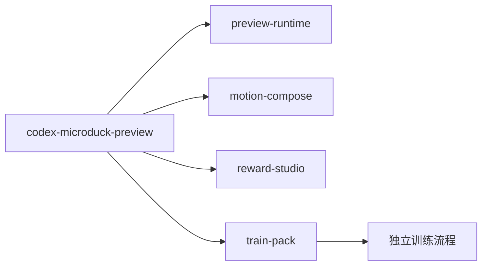

# Microduck Preview Skill 优化计划

本 skill 今天只做一件事：把自然语言变成运动学预览。要变成「指令可视化 + 奖励/惩罚卡片 + 训练包」，应拆成 **1 个父 skill + 4 个子 skill**。不要在这个仓库里另写 PPO；审核包按本项目的训练输入合同导出；物理预检直接复用训练仓库现有 CPU/BAM 运行时，不依赖任何外部动作模仿 skill。

## 子 skill 清单（推荐 4 个，可选再加 2 个）

父 skill [`codex-microduck-preview/SKILL.md`](codex-microduck-preview/SKILL.md) 只做分发：判断用户是在调动作、调奖励、看预览，还是要打包训练。

1. **`microduck-preview-runtime`**（现有能力收紧）
   - 触发：doctor、启动服务、打开 viewer、报 DEMO/降级。
   - 覆盖 CLI、本地服务、MuJoCo 侧栏。
   - 先修这次暴露的问题：默认资产路径、端口冲突、Cursor 会话 ID。

2. **`microduck-motion-compose`**（指令 / 预期效果）
   - 触发：「向左走再单脚站」、微调步长/半径、改分段顺序。
   - 把 `composite` 从「直行+转弯」扩成时间轴：走、转弯、侧移或左转替代、悬停、站立保持。
   - 产出 `motion.json` + `command.json`（逐帧 vx/wz、阶段标签、支撑脚）。

3. **`microduck-reward-studio`**（奖励/惩罚卡片）
   - 触发：增加/删除奖励项、改权重、看某一项在衡量什么。
   - 目录只登记训练仓库已有函数，不在界面里生成新奖励代码。
   - 每张卡片：释义短片、权重滑块、参数、生效时段、状态（仅释义 / 已试训）。

4. **`microduck-train-pack`**（打包给训练）
   - 触发：「可以训练了」「导出审核包」。
   - 绑定 `motion.json`、`command.json`、`rewards.json`、`task_criteria.json`、物理预检。
   - 用户确认后将审核包交给独立训练流程；本项目不提供 approve/train 命令，不启动 PPO。

可选（第二轮再拆，避免一开始技能过多、路由混乱）：

5. **`microduck-explain-clip`**：只负责扰动轨迹和卡片短片缓存。第一轮可内嵌在 reward-studio。
6. **`microduck-trial-compare`**：小规模试训后回填分项曲线。依赖训练入口打通后再做。

不要再拆「打开浏览器」「导出 MP4」这类内部步骤；它们仍是 runtime 的命令。

## 第一阶段：把现有 skill 跑稳

不改产品形态，先让 Cursor 下可重复使用。

- 默认 `assetsRoot` 从 Python 解释器推出，或写进项目配置，不再指向不存在的 [`~/Desktop/RL研发/microduck-marseille`](codex-microduck-preview/lib/config.mjs)。
- 端口占用时换空闲端口，或报出占用方的 `projectRoot`；[`ensureService`](codex-microduck-preview/scripts/microduck.mjs) 不要只给「未能启动」。
- [`inheritParams`](dsh-microduck-preview/lib/spec.js) 按当前 `pattern` 只继承相关字段，避免 hover 吃进上一段 `segments`。
- 任务历史标签用分段摘要，而不是一律「前进 · 多段组合」。
- SKILL.md 补 Cursor 用法：没有 `CODEX_THREAD_ID` 时用当前 chat id；用内置浏览器打开 `viewer_url`。
- 统一 hover 默认抬脚高度：`author_walk.py` 用 0.05，界面/README 用 0.04。

## 第二阶段：时间轴指令

改 [`author_walk.py`](dsh-microduck-preview/pipeline/author_walk.py) 的 `normalize_segments` 和 [`spec.js`](dsh-microduck-preview/lib/spec.js)：

- 新分段：`hover`、`stand`；可选 `sidestep`，没有横移时明确降级为「左转再直行」并写进 warnings。
- 相邻分段自动过渡，保证「向左走然后单脚站」是一条参考轨迹，而不是两个无关任务。
- UI 把 [`index.html`](codex-microduck-preview/assets/index.html) 里的 JSON textarea 换成时间轴编辑器，并画逐帧指令曲线。
- 单次 preview 仍走现有 `run_preview.py`；额外写出 `command.json`。

## 第三阶段：奖励目录和卡片 UI

新增 `rewards/catalog.json`（skill 侧）和 CLI：`rewards list|add|remove|set`。

每条目录项必须能在 [`microduck_rl-develop`](/Users/founderlin/agent_zoo/microduck_rl-develop/src/mjlab_microduck/tasks/microduck_velocity_env_cfg.py) 解析到真实函数，例如 `track_linear_velocity`、`upright`、`air_time`、`foot_slip`、`self_collisions`。`doctor` 校验函数和参数名；对不上的卡片标红且不可启用。

卡片规则：

- 符号固定：奖励权重 ≥ 0，惩罚 ≤ 0，只调幅度。
- 走路 / 悬停用不同预设；未启用项不进入训练包。
- 改权重或增删项生成新 `rewards.json` 版本，绑定到当前动作任务。
- 第一轮可以没有短片，卡片先能调参和看说明。

## 第四阶段：释义短片

复用 [`frame_server.py`](dsh-microduck-preview/pipeline/frame_server.py)：

- 在参考轨迹上加可控扰动（支撑脚漂移、机身倾斜、拖步、抬脚变低）。
- **必须调用训练仓库同一个奖励函数**打分，左右对比「正常 vs 扰动」+ 得分曲线。
- 用短 MP4/WebM，不用 GIF；按「动作哈希 + 项 id + 参数」缓存。
- 舵机堵转、力矩等运动学算不出的项标「仅训练后可见」，不放假动画。

## 第五阶段：训练包

新增命令 `pack --task <id>`，目录对齐本项目审核包的最小子集：

- `motion.json`（已有，50 Hz / 14 关节）
- `command.json`、`rewards.json`、`task_criteria.json`
- `physics.json`：调用 训练仓库 CPU/BAM 入口 的 BAM 预检，不能省略
- `review.json`：上述文件哈希

确认动作版本后才允许 handoff。奖励权重可在动作不变时改，但必须新开试训阶段。本仓库到此为止；真正训练由独立训练流程实施；本项目仅直接复用训练仓库的 CPU/BAM 运行时做物理预检。

## 明确不做

- 不在预览 skill 里实现 PPO、改 mjlab 任务注册、或自动生成新奖励 Python。
- 不把几何通过说成可训练或可上实机。
- 不把释义短片标成「调这个权重后策略会长成这样」。

## 建议落地顺序

先做阶段 1 + 父 skill 分发说明；再做阶段 2（没有串联轨迹就无法打包）；然后阶段 3 的目录和卡片；短片和训练包作为后续增量。
